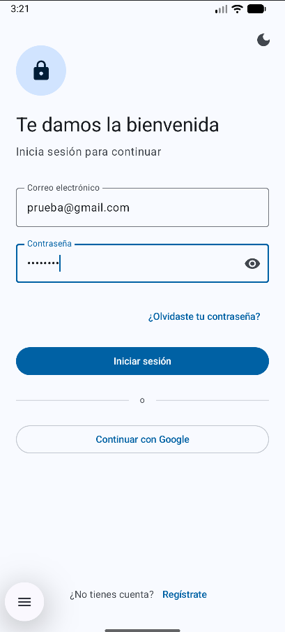
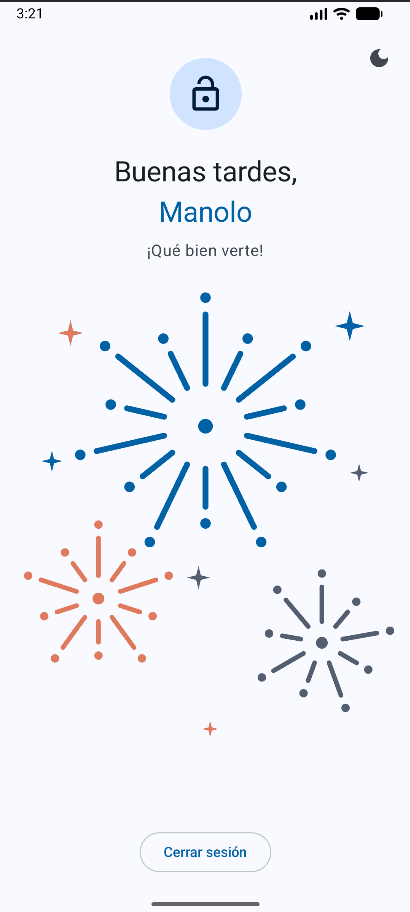
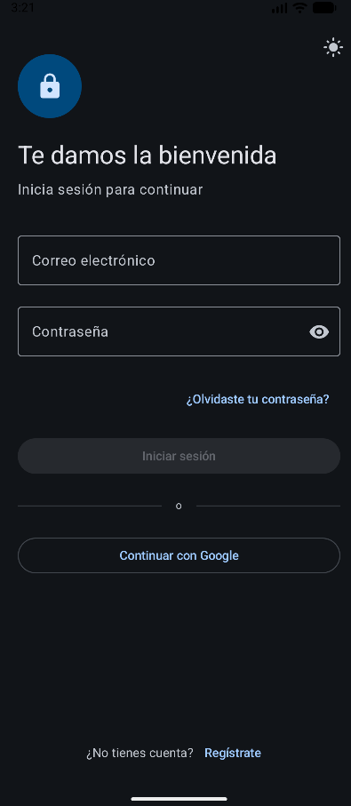
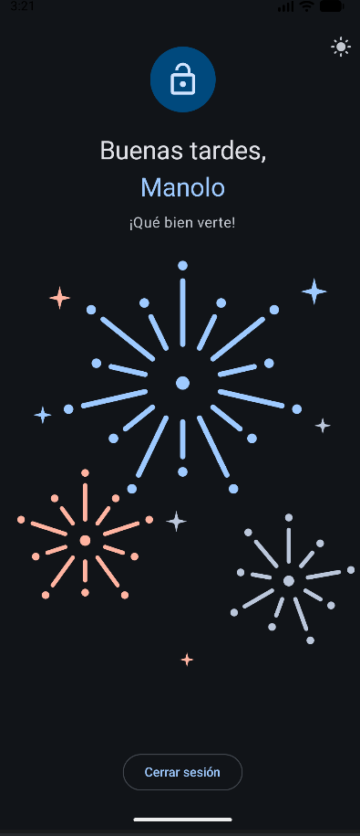
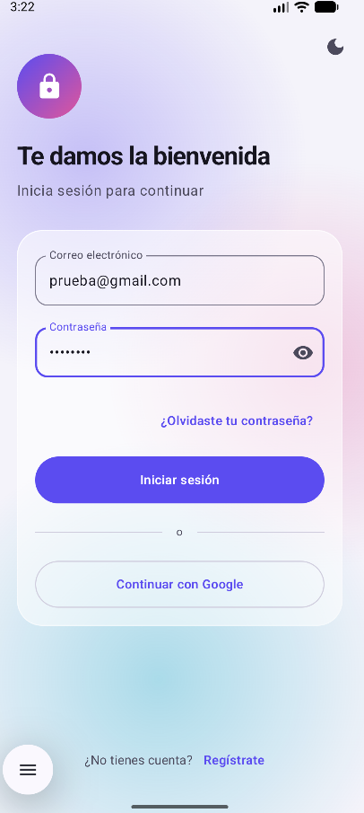
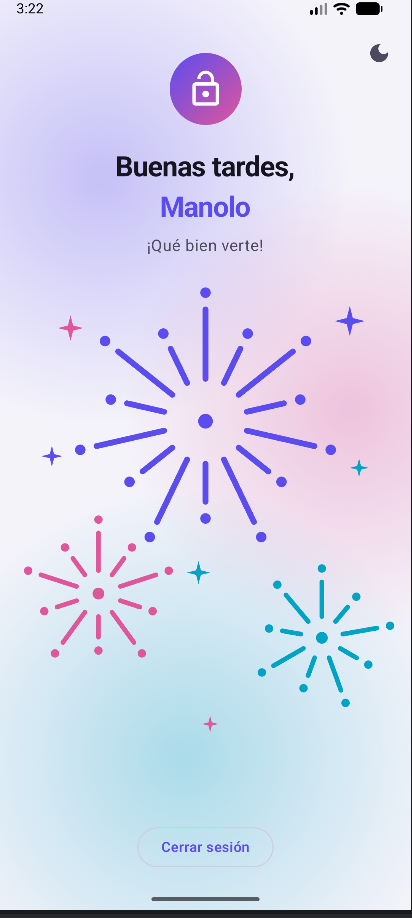
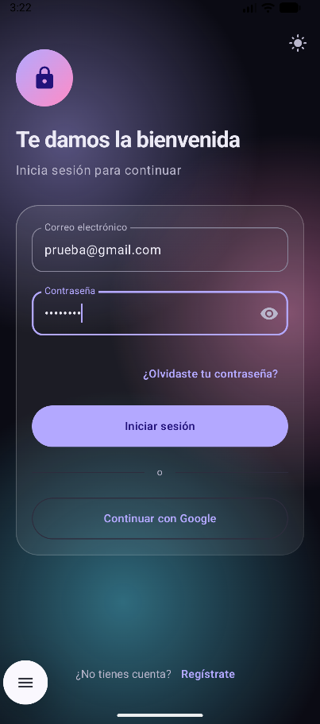
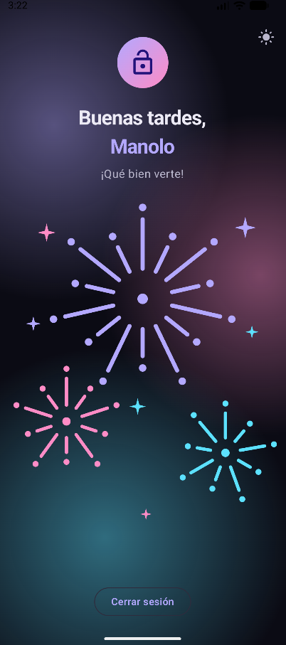

# Login Compose 

App de login hecha con Jetpack Compose y Material 3:

## Usuario de prueba

| Campo       | Valor              |
|-------------|--------------------|
| Correo      | prueba@gmail.com    |
| Contraseña  | prueba12         |

> Los datos están en `LoginViewModel.kt` (son de prueba, no hay servidor real).
> La contraseña debe tener mínimo 8 caracteres para que se active el botón.

## Versiones del diseño

El proyecto tiene dos ramas con la misma lógica y distinta estética.

### `master`: plantilla original

| | Login | Bienvenida |
|---|---|---|
| **Modo claro** |  |  |
| **Modo oscuro** |  |  |

### `new-style`: estilo cristal (glassmorphism)

| | Login | Bienvenida |
|---|---|---|
| **Modo claro** |  |  |
| **Modo oscuro** |  |  |